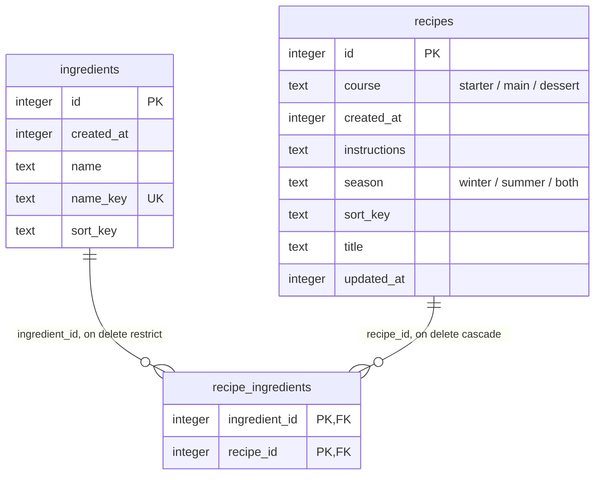

# Database

Local-only SQLite (`expo-sqlite`) accessed through Drizzle ORM. The schema lives in `src/db/schema.ts`; migrations are generated into `src/db/migrations/` and applied at startup.

## Schema

<!-- db-diagram:start -->
<!-- Generated from src/db/schema.ts by `npm run db:diagram`: don't edit by hand. -->

Integer primary keys are SQLite rowids.

| Table                | Index                                      | Columns                      | Unique |
| -------------------- | ------------------------------------------ | ---------------------------- | ------ |
| `ingredients`        | `ingredients_name_key_unique`              | `name_key`                   | yes    |
| `ingredients`        | `ingredients_sort_key_id_idx`              | `sort_key`, `id`             |        |
| `recipe_ingredients` | primary key                                | `recipe_id`, `ingredient_id` | yes    |
| `recipe_ingredients` | `recipe_ingredients_ingredient_recipe_idx` | `ingredient_id`, `recipe_id` |        |
| `recipes`            | `recipes_sort_key_id_idx`                  | `sort_key`, `id`             |        |

<!-- db-diagram:end -->

- **Ingredients are unique** by `name_key` (trimmed, single spaces, lower case, computed by `toNameKey` in `src/lib/text.ts`). Case is ignored, accents are not (`pâte` ≠ `pâté`). The key is computed in JS because SQLite's `NOCASE` only folds ASCII (`Œuf` vs `œuf`).
- **Many-to-many** through `recipe_ingredients`: its composite primary key forbids duplicate links and serves "ingredients of a recipe"; the reverse index serves "recipes using an ingredient". Both cover their queries (no table lookup).
- **Deleting**: a recipe cascades to its links; an ingredient still used by a recipe can't be deleted (`RESTRICT`, and the UI hides the button).
- **Constraints in the database**, not only in the UI: `CHECK` on the season and course values and on non-blank names/titles, `NOT NULL`, foreign keys (`PRAGMA foreign_keys = ON` on every connection, since SQLite disables them by default).
- **Integer primary keys** are SQLite's rowid: the fastest lookups and joins. If sync between devices comes later, add a UUID column then.
- **No index on `season` or `course`**: with 3 values each, an index can't beat scanning the table.
- **Every recipe has a course** (`NOT NULL`, `'main'` by default): a recipe always matches a course filter of its own course, and the form offers no "none".

## Performance choices

| Choice                                      | Why                                                                                                                                                                                                                                                                                                                                                                                                                                                                                                              |
| ------------------------------------------- | ---------------------------------------------------------------------------------------------------------------------------------------------------------------------------------------------------------------------------------------------------------------------------------------------------------------------------------------------------------------------------------------------------------------------------------------------------------------------------------------------------------------- |
| WAL journal mode                            | Faster writes; reads never wait for a write.                                                                                                                                                                                                                                                                                                                                                                                                                                                                     |
| Synchronous queries (Drizzle's expo driver) | Sub-millisecond on this data size; screens get data on the first render, so no loading flash.                                                                                                                                                                                                                                                                                                                                                                                                                    |
| TanStack Query, invalidated after writes    | Screens read through `useQuery` / `useInfiniteQuery` (`src/features/*/hooks`). Every write made through Drizzle invalidates them (`src/db/change-notifier.ts` reads its logger), once per batch, cascaded deletes included. Queries are synchronous: the first result is the `initialData`, so there's no loading flash.                                                                                                                                                                                         |
| Lists: 50 rows per query, keyset pagination | `usePagedQuery` loads pages of `PAGE_SIZE` (50) with `WHERE (sort_key, id) > cursor ORDER BY sort_key, id LIMIT 51` on a `(sort_key, id)` index: every page costs the same, unlike `OFFSET`. Infinite scroll; at most `MAX_PAGES` (2) stay in memory, the others reload when scrolling back. Pickers ask for 12 suggestions with `LIMIT`.                                                                                                                                                                        |
| List queries skip `instructions`            | It can be long; only the recipe screen reads it.                                                                                                                                                                                                                                                                                                                                                                                                                                                                 |
| Counts in the row                           | Usage and ingredient counts come with each row from a correlated `count(*)` on the covering link indexes: no N+1 queries, and the page still reads in index order.                                                                                                                                                                                                                                                                                                                                               |
| Recipe filters in SQL                       | The recipe list's search and filters (title, season, course, "all selected ingredients") are one `WHERE` (`filtersWhere`), shared by its pages, its `countRecipes` and the meal choice's `pickRandomRecipeId`. "All selected ingredients" = links of those ingredients grouped by recipe, `HAVING count(*) = n`, starting from the `(ingredient_id, recipe_id)` index. Pages walk the `(sort_key, id)` index; with ingredients selected, SQLite starts from the recipes using them instead and sorts only those. |
| Meal choice: one row                        | `pickRandomRecipeId`: a count, then one id at a random `OFFSET` (excluding the previous suggestion), never the list of ids.                                                                                                                                                                                                                                                                                                                                                                                      |
| `sort_key` columns                          | SQLite sorts bytes and can't strip accents, so `Échalote` would come after `zucchini`. `sort_key` (no case, no accents, computed in JS by `toSortKey`) is what lists sort and search on, in SQL.                                                                                                                                                                                                                                                                                                                 |

`src/db/query-plans.test.ts` runs `EXPLAIN QUERY PLAN` on these queries and fails if one stops using its index.

## Changing the schema

**Until the first release, there are no users and no data to keep**: the schema has a single migration, `0000_init.sql`, regenerated on every change.

1. Edit `src/db/schema.ts`.
2. Delete `src/db/migrations/` and run `npm run db:generate -- --name init`. It also regenerates the diagram above (`npm run db:diagram`; CI fails if it's out of date, and attaches it as an image to each release). Commit the result.
3. Reset the app's data on your device or emulator (`adb shell pm clear io.github.someoneinthe.dishescook`): an existing database already has the old `0000` applied.
4. Restart Metro with `npx expo start --dev-client --clear`: it caches the inlined `.sql` files by `migrations.js`, so it would keep serving the old SQL.

Migrations run at startup (`DatabaseProvider`), before any screen renders.

**After the first release**, migrations must keep users' data: never edit a shipped migration, add new ones with `npm run db:generate`, and read the generated SQL. For changes `ALTER TABLE` can't express (a table-level `CHECK`, for instance), drizzle-kit rebuilds the table (copy, `DROP TABLE`, rename) inside `PRAGMA foreign_keys=OFF`, which has no effect in the migration transaction: dropping `recipes` would cascade-delete every `recipe_ingredients` row. Hand-write an `ALTER TABLE … ADD` instead when it can do the job, and test that existing rows survive.

Drinks (planned) will likely reuse `recipes` with a `kind` column (`'dish' | 'drink'`) so they share ingredients, live queries and the random pick.

## Tests

Query and screen tests run on a real in-memory SQLite (`better-sqlite3`, the same engine and the same migrations as the app) via `createTestConnection` and `renderWithDatabase` from `src/test/test-database.tsx`.
