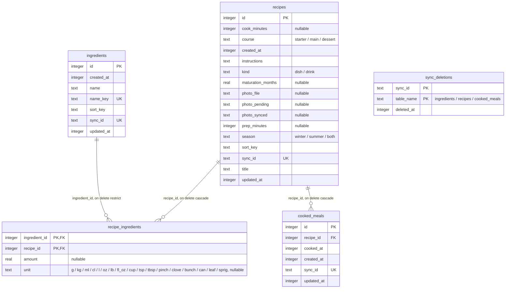

# Database

Local SQLite (`expo-sqlite`) accessed through Drizzle ORM: the phone's data, optionally synced with a server (see [sync.md](sync.md)). The schema lives in `src/db/schema.ts`; migrations are generated into `src/db/migrations/` and applied at startup.

## Schema

<!-- db-diagram:start -->
<!-- Generated from src/db/schema.ts by `npm run db:diagram`: don't edit by hand. -->

Integer primary keys are SQLite rowids.

| Table                | Index                                      | Columns                      | Unique |
| -------------------- | ------------------------------------------ | ---------------------------- | ------ |
| `cooked_meals`       | `cooked_meals_sync_id_unique`              | `sync_id`                    | yes    |
| `cooked_meals`       | `cooked_meals_updated_at_id_idx`           | `updated_at`, `id`           |        |
| `cooked_meals`       | `cooked_meals_recipe_cooked_at_idx`        | `recipe_id`, `cooked_at`     |        |
| `ingredients`        | `ingredients_sync_id_unique`               | `sync_id`                    | yes    |
| `ingredients`        | `ingredients_updated_at_id_idx`            | `updated_at`, `id`           |        |
| `ingredients`        | `ingredients_name_key_unique`              | `name_key`                   | yes    |
| `ingredients`        | `ingredients_sort_key_id_idx`              | `sort_key`, `id`             |        |
| `recipe_ingredients` | primary key                                | `recipe_id`, `ingredient_id` | yes    |
| `recipe_ingredients` | `recipe_ingredients_ingredient_recipe_idx` | `ingredient_id`, `recipe_id` |        |
| `recipes`            | `recipes_sync_id_unique`                   | `sync_id`                    | yes    |
| `recipes`            | `recipes_updated_at_id_idx`                | `updated_at`, `id`           |        |
| `recipes`            | `recipes_kind_sort_key_id_idx`             | `kind`, `sort_key`, `id`     |        |
| `sync_deletions`     | primary key                                | `table_name`, `sync_id`      | yes    |

<!-- db-diagram:end -->

- **Ingredients are unique** by `name_key` (trimmed, single spaces, lower case, computed by `toNameKey` in `src/lib/text.ts`). Case is ignored, accents are not (`pâte` ≠ `pâté`). The key is computed in JS because SQLite's `NOCASE` only folds ASCII (`Œuf` vs `œuf`).
- **Many-to-many** through `recipe_ingredients`: its composite primary key forbids duplicate links and serves "ingredients of a recipe"; the reverse index serves "recipes using an ingredient" and covers its queries (no table lookup). Reading a recipe's ingredients also reads each link's quantity from its row.
- **Quantities** live on the link (`recipe_ingredients.amount` and `unit`), **normalized**: weights in grams (`g`) and volumes in millilitres (`ml`), whatever unit they were typed in (1.5 kg is stored as 1500 g, 8 oz as 226.8 g). Spoons (`tsp`, `tbsp`) and counted units (`pinch`, `clove`, `bunch`, `can`, `leaf`, `sprig`) are stored as written, no unit = pieces, no amount = no quantity ("salt"). The unit is chosen on display, in the reader's units (Settings › Units): the closest one, 1000 g → 1 kg, or 2.25 lb in US units (`src/lib/units.ts`). Editing rewrites only the rows the user changed, so a value never drifts through display rounding. Normalized amounts add up directly (the shopping list, item 14). Amounts are checked by `toQuantity` in the code that writes them: a `CHECK` added to an existing table makes drizzle-kit rebuild it.
- **Meal history**: `cooked_meals` has one row each time a recipe is cooked (`cooked_at`, in ms). Rows are only added and removed, never edited, and marking a recipe as cooked doesn't touch the recipe row: it isn't pushed again, so it can't overwrite an edit made on another phone (see [sync.md › Known limits](sync.md#known-limits)). The `(recipe_id, cooked_at)` index serves a recipe's last time cooked (the end of its entries) and the meal choice's "not cooked since".
- **Times and photo** on `recipes`: `prep_minutes` and `cook_minutes` (whole minutes, checked by `toMinutes` in the code, null = not given), and the photo's file in the app's documents (`photo_file`, a JPEG resized to 1280 px) with the server names the sync needs (`photo_synced`, `photo_pending`, see [sync.md](sync.md#how-it-works)). Files no recipe uses are deleted at start (`deleteUnusedPhotos`).
- **Deleting**: a recipe cascades to its links and its meal history; an ingredient still used by a recipe can't be deleted (`RESTRICT`, and the UI hides the button).
- **Constraints in the database**, not only in the UI: `CHECK` on the season and course values and on non-blank names/titles, `NOT NULL`, foreign keys (`PRAGMA foreign_keys = ON` on every connection, since SQLite disables them by default).
- **Integer primary keys** are SQLite's rowid: the fastest lookups and joins. They stay on the phone: across devices and on the server a row is its `sync_id` (15 characters of `[0-9a-f]`, the server's id format): random for recipes, derived from the name for ingredients, so the same ingredient added on two phones is one row (see [sync.md](sync.md)).
- **Sync bookkeeping**: `updated_at` on the synced tables (newer rows are pushed, the newest change wins), and `sync_deletions`, written by the delete queries in the same transaction, until the server is told.
- **No index on `season` or `course`**: with 3 values each, an index can't beat scanning the table.
- **Every recipe has a course** (`NOT NULL`, `'main'` by default): a recipe always matches a course filter of its own course, and the form offers no "none".

## Performance choices

| Choice                                      | Why                                                                                                                                                                                                                                                                                                                                                                                                                                                                                                              |
| ------------------------------------------- | ---------------------------------------------------------------------------------------------------------------------------------------------------------------------------------------------------------------------------------------------------------------------------------------------------------------------------------------------------------------------------------------------------------------------------------------------------------------------------------------------------------------- |
| WAL journal mode                            | Faster writes; reads never wait for a write.                                                                                                                                                                                                                                                                                                                                                                                                                                                                     |
| Synchronous queries (Drizzle's expo driver) | Sub-millisecond on this data size; screens get data on the first render, so no loading flash.                                                                                                                                                                                                                                                                                                                                                                                                                    |
| TanStack Query, invalidated after writes    | Screens read through `useQuery` / `useInfiniteQuery` (`src/features/*/hooks`). Every write made through Drizzle invalidates them (`src/db/change-notifier.ts` reads its logger), once per batch, cascaded deletes included; a sync's writes once, at its end. Queries are synchronous: the first result is the `initialData`, so there's no loading flash.                                                                                                                                                       |
| Lists: 50 rows per query, keyset pagination | `usePagedQuery` loads pages of `PAGE_SIZE` (50) with `WHERE (sort_key, id) > cursor ORDER BY sort_key, id LIMIT 51` on a `(sort_key, id)` index: every page costs the same, unlike `OFFSET`. Infinite scroll; at most `MAX_PAGES` (2) stay in memory, the others reload when scrolling back. Pickers ask for 12 suggestions with `LIMIT`.                                                                                                                                                                        |
| List queries skip `instructions`            | It can be long; only the recipe screen reads it.                                                                                                                                                                                                                                                                                                                                                                                                                                                                 |
| Counts in the row                           | Usage and ingredient counts come with each row from a correlated `count(*)` on the covering link indexes: no N+1 queries, and the page still reads in index order.                                                                                                                                                                                                                                                                                                                                               |
| Recipe filters in SQL                       | The recipe list's search and filters (title, season, course, "all selected ingredients") are one `WHERE` (`filtersWhere`), shared by its pages, its `countRecipes` and the meal choice's `pickRandomRecipeId`. "All selected ingredients" = links of those ingredients grouped by recipe, `HAVING count(*) = n`, starting from the `(ingredient_id, recipe_id)` index. Pages walk the `(sort_key, id)` index; with ingredients selected, SQLite starts from the recipes using them instead and sorts only those. |
| Meal choice: one row                        | `pickRandomRecipeId`: a count, then one id at a random `OFFSET` (excluding the previous suggestion), never the list of ids. The recipes cooked recently (Settings › Skip recent meals) are left out with a `NOT EXISTS` on the `(recipe_id, cooked_at)` index; when every match was, the one cooked longest ago is picked, sorted by its last meal (one index lookup each, among the few cooked recently).                                                                                                       |
| Shopping list: SQL sums                     | `listShoppingLines` adds up the picked meals' quantities per ingredient and unit (`SUM` … `GROUP BY ingredient_id, unit`), from the links' primary key, at most 50 meals (`MAX_PICKS`, the picks themselves live in memory only). Normalized amounts add up directly; the screen only puts the lines of one ingredient together ("Leek: 3 + 200 g").                                                                                                                                                             |
| `sort_key` columns                          | SQLite sorts bytes and can't strip accents, so `Échalote` would come after `zucchini`. `sort_key` (no case, no accents, computed in JS by `toSortKey`) is what lists sort and search on, in SQL.                                                                                                                                                                                                                                                                                                                 |

`src/db/query-plans.test.ts` runs `EXPLAIN QUERY PLAN` on these queries and fails if one stops using its index.

## Changing the schema

**Migrations are additive**: phones and the sync server keep real data, so a schema change never resets it. Migrations run at startup (`DatabaseProvider`), before any screen renders, and Drizzle only applies the ones newer than the last it recorded: an edit to a migration that already ran never reaches existing databases.

1. Edit `src/db/schema.ts`.
2. Run `npm run db:generate -- --name <what-changes>` (e.g. `--name recipe-servings`). It adds `src/db/migrations/<NNNN>_<what-changes>.sql` and regenerates the diagram above (`npm run db:diagram`; CI fails if it's out of date, and attaches it as an image to each release).
3. Read the generated SQL (see below), and add a test that rows written before the migration survive it.
4. Restart Metro with `npx expo start --dev-client --clear`: it caches the inlined `.sql` files by `migrations.js`, so it would keep serving the old SQL. The app applies the new migration on its next start; don't clear its data.
5. Record the new migration's checksum in `src/db/frozen-migrations.test.ts` (the failing test prints it), then commit.

While the PR is open you can delete your new migration and generate it again; once merged, it's frozen: `frozen-migrations.test.ts` fails if a shipped migration changes. Fix a mistake with another migration.

**Read the generated SQL**: for changes `ALTER TABLE` can't express (a table-level `CHECK`, for instance), drizzle-kit rebuilds the table (copy, `DROP TABLE`, rename) inside `PRAGMA foreign_keys=OFF`, which has no effect in the migration transaction: dropping `recipes` would cascade-delete every `recipe_ingredients` row. Hand-write an `ALTER TABLE … ADD` instead when it can do the job. A new column on an existing table needs a default (or to be nullable) for the rows already there.

A change to a synced table (`recipes`, `ingredients`, `recipe_ingredients`, `cooked_meals`) usually needs a server migration too: a new file in `server/migrations/`, frozen the same way, and added to `SERVER_MIGRATION_LIST` so the app checks the server has it (see [sync.md › Versions](sync.md#versions)). Once merged, deploy it (`npm run server:deploy`, see [sync.md › Updating the server](sync.md#updating-the-server)).

**Drinks** are recipes too: `recipes.kind` is `'dish'` (the default) or `'drink'`, so they share ingredients, photos, quantities and the sync. Every list, count and random pick asks for one kind (`RecipeFilters.kind`) and walks the `(kind, sort_key, id)` index; with an ingredient filter, `+kind` keeps the plan on the ingredient index instead. A drink's `course` and `season` are unused (left at `main` and `both`), it has no meal history, and Meal choice only picks dishes. The kind is checked by the code that writes it (no `CHECK`: adding one would rebuild the table).

## Tests

Query and screen tests run on a real in-memory SQLite (`better-sqlite3`, the same engine and the same migrations as the app) via `createTestConnection` and `renderWithDatabase` from `src/test/test-database.tsx`.
